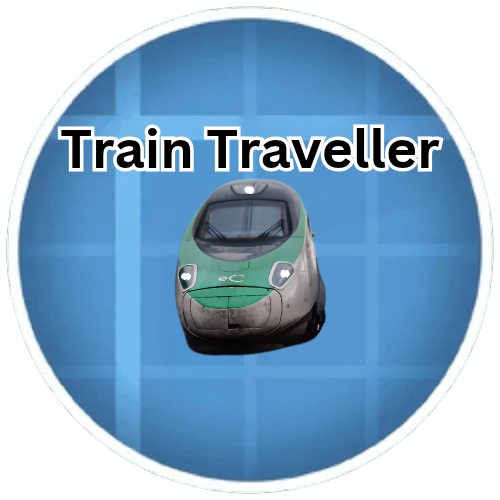

<p align="center">
  
</p>

<h1 align="center">🚆 Create: Train Traveller</h1>

<p align="center">
  A server-side <strong>NeoForge</strong> mod for <strong>Minecraft 1.21.1</strong> that provides a real-time web dashboard and telemetry API for <strong>Create</strong> and <strong>Create Railways Navigator (CRN)</strong>.
</p>

---

Monitor your server's railway network, active trains, stations, delays, and timetables directly from your browser—designed for multiplayer servers and complex railway infrastructures.

## ✨ Current Features (`v0.0.2-alpha`)

* **Built-in Web Server & REST API:** Lightweight embedded HTTP server hosting both static web assets and JSON telemetry endpoints.
* **`/traintraveller website` Command:** In-game command returning a clickable link to the server's live web dashboard.
* **English Web Dashboard:** Full English interface with real-time train, station, line, and schedule tracking.
* **Server-Side Only:** Players can join the server with a vanilla or standard modded client without needing to install *Create: Train Traveller* locally (`IGNORE_ALL_VERSION`).
* **Port Isolation:** Configurable port (`25581` by default) to run smoothly alongside Create Railways Navigator's internal web server (`25580`).
* **Optional API Authentication:** Configurable API key protection for external integrations.

---

## 🗺️ Planned Features (Roadmap)

* **Customizable Train Category Logos:** Ability to assign custom icons/logos to specific train categories (e.g., High-Speed, Regional, Intercity, Cargo) on the web dashboard.
* **Railway Companies System:** Support for organizing lines, trains, and liveries under distinct railway operators/companies (*nothing dome*).

---

## 📦 Requirements

* **Minecraft:** `1.21.1`
* **Mod Loader:** `NeoForge 21.1.248` or higher
* **Required Mods:**
  * [Create Railways Navigator](https://modrinth.com/mod/create-railways-navigator) *(which includes Create)*

---

## ⚙️ Configuration

After launching the server once, a configuration file will be generated at:
`config/createtraintraveller-common.toml`

```toml
# Port used to host the web server and API endpoints (default: 25581 to avoid conflicts with CRN)
apiPort = 25581

# Public IP address or domain shown by /traintraveller website (leave empty for http://localhost:<port>)
publicHost = ""

# Optional secret key required in the X-API-Key header (leave empty to disable)
apiKey = ""